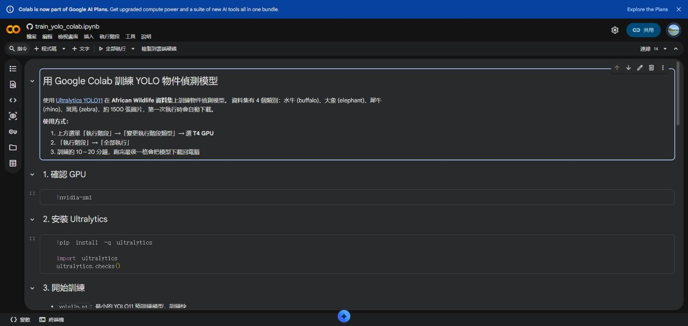
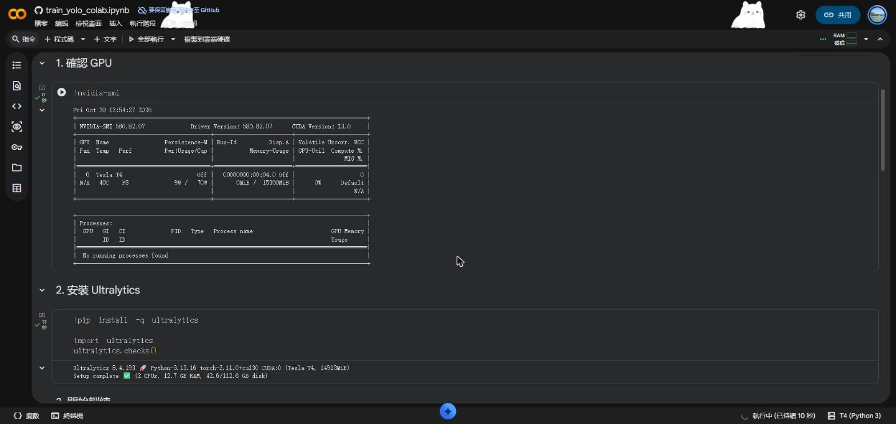
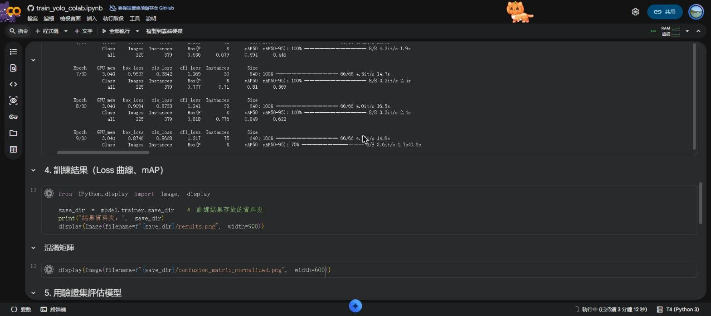
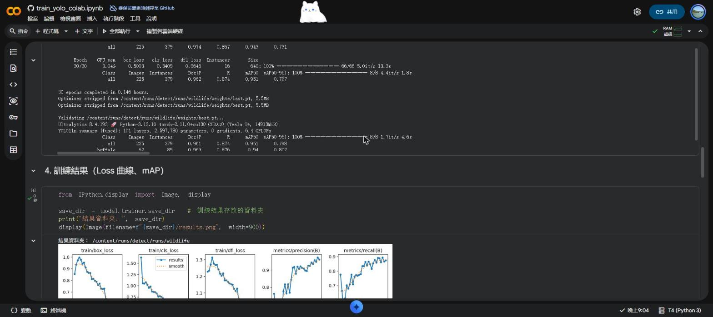
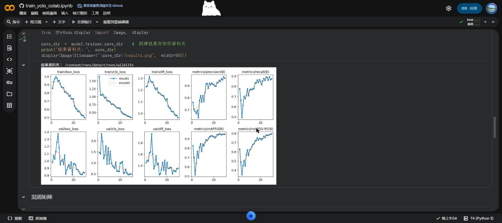
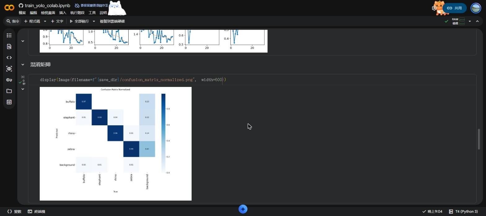
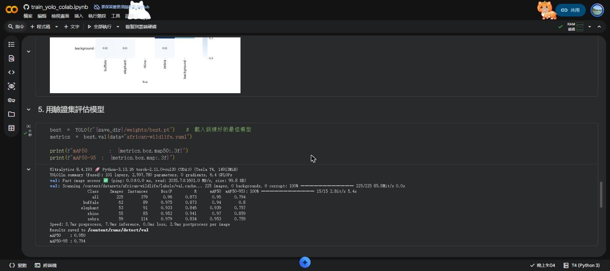
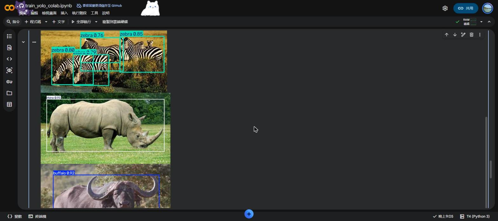
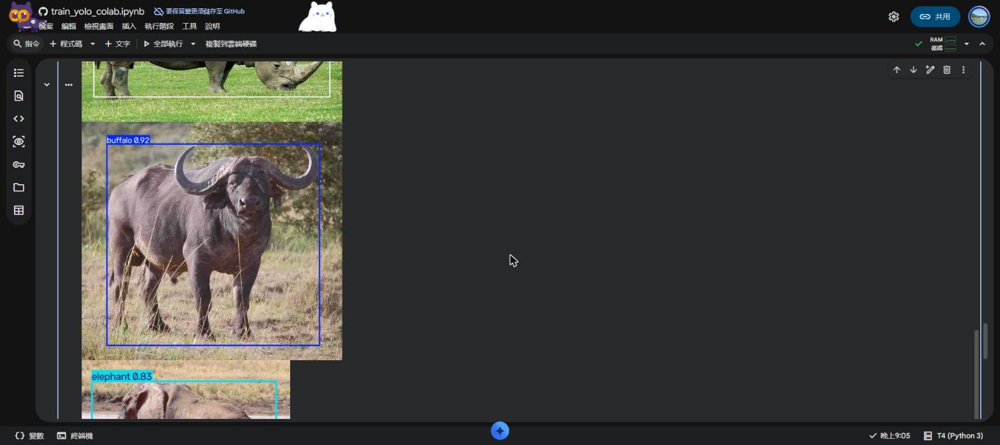
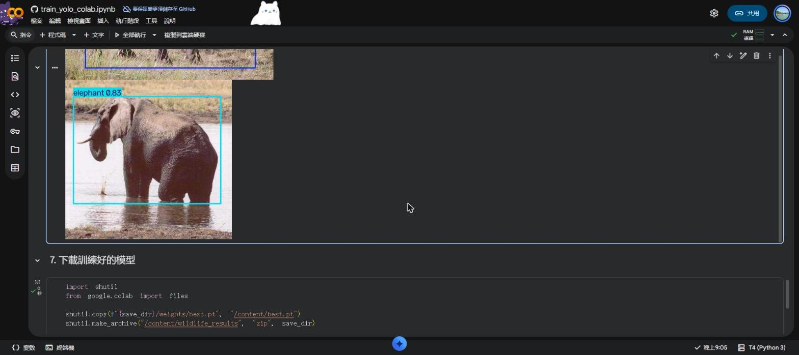

# YOLO 物件偵測訓練報告（Google Colab）
組員:11325033蔡慶陞、11325035劉晉維

[](https://colab.research.google.com/github/RK-Prts/yolo-colab/blob/main/train_yolo_colab.ipynb)

## 一、目標

使用 Google Colab 的免費 GPU，以 [Ultralytics YOLO11](https://docs.ultralytics.com/) 訓練一個物件偵測模型，能辨識 4 種非洲野生動物。

## 二、環境與資料集

| 項目 | 內容 |
|---|---|
| 平台 | Google Colab |
| GPU | NVIDIA Tesla T4（15 GB） |
| 套件 | Ultralytics 8.4.193、PyTorch 2.11.0、Python 3.13 |
| 模型 | YOLO11n（預訓練權重 `yolo11n.pt`） |
| 資料集 | [African Wildlife](https://docs.ultralytics.com/datasets/detect/african-wildlife/)，約 1500 張圖片 |

資料集類別：

| 編號 | 類別 |
|---|---|
| 0 | buffalo（水牛） |
| 1 | elephant（大象） |
| 2 | rhino（犀牛） |
| 3 | zebra（斑馬） |

## 三、訓練參數

| 參數 | 值 |
|---|---|
| epochs | 30 |
| 圖片大小 imgsz | 640 |
| batch | 16 |

```python
from ultralytics import YOLO

model = YOLO("yolo11n.pt")
results = model.train(data="african-wildlife.yaml", epochs=30, imgsz=640, batch=16)
```

## 四、執行過程

### 1. 在 Colab 開啟 notebook

從 GitHub 直接用 Colab 開啟 `train_yolo_colab.ipynb`，執行階段選擇 T4 GPU，按「全部執行」。



### 2. 確認 GPU 並安裝 Ultralytics

`nvidia-smi` 顯示分配到 Tesla T4，安裝 Ultralytics 後環境檢查通過。



### 3. 開始訓練

資料集自動下載後開始訓練，每個 epoch 約 15 秒。下圖可看到 loss 逐漸下降、mAP 逐漸上升。



### 4. 訓練完成

30 個 epoch 共花費約 **9 分鐘**（0.146 小時），最佳模型存成 `best.pt`。



## 五、訓練結果

### Loss 與評估指標曲線

訓練與驗證的 box / cls / dfl loss 都持續下降，precision、recall、mAP 持續上升，沒有明顯過擬合。



### 混淆矩陣

4 個類別的正確率都在 96% 以上，主要的錯誤來自把背景誤判為動物。



### 驗證集評估



| 類別 | 圖片數 | 物件數 | Precision | Recall | mAP50 | mAP50-95 |
|---|---|---|---|---|---|---|
| **全部** | 225 | 379 | 0.960 | 0.873 | **0.950** | **0.794** |
| buffalo | 62 | 89 | 0.975 | 0.873 | 0.940 | 0.800 |
| elephant | 53 | 91 | 0.933 | 0.846 | 0.939 | 0.757 |
| rhino | 55 | 85 | 0.952 | 0.941 | 0.970 | 0.859 |
| zebra | 59 | 114 | 0.979 | 0.834 | 0.953 | 0.759 |

## 六、測試圖片預測

從測試集隨機挑選圖片，用訓練好的模型做預測，框出動物並標示類別與信心分數。







## 七、結論

- 只用 30 個 epoch、約 9 分鐘，模型在驗證集上達到 **mAP50 = 0.950**、**mAP50-95 = 0.794**。
- 4 種動物都能正確辨識，犀牛的表現最好（mAP50 0.970）。
- 多隻斑馬重疊時仍能分別框出，但部分框的信心分數較低（約 0.76～0.85）。
- 若要再提升效果，可以增加 epochs 或改用較大的模型（如 `yolo11s`）。

## 檔案說明

| 檔案 | 說明 |
|---|---|
| `train_yolo_colab.ipynb` | Colab 訓練用 notebook |
| `weights/best.pt` | 訓練好的模型權重 |
| `screenshots/` | 執行過程截圖 |

## 如何重現

1. 點上方的 **Open in Colab**
2. 「執行階段」→「變更執行階段類型」→ 選 **T4 GPU**
3. 「執行階段」→「全部執行」

## 使用訓練好的模型

```python
from ultralytics import YOLO

model = YOLO("weights/best.pt")
model.predict("你的圖片.jpg", save=True)
```
